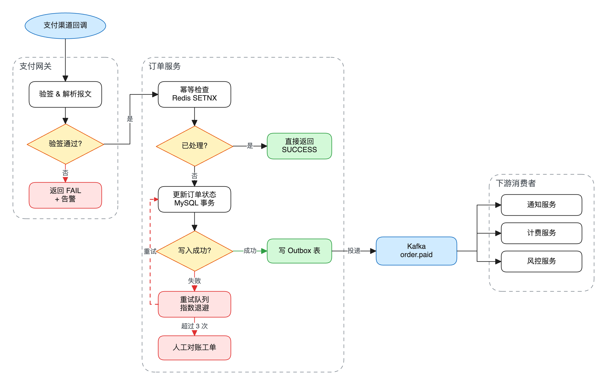

# excalidraw-diagram

[English](README.md) | **简体中文**

Claude Code 插件：画技术图，包括流程图、架构图、时序图、数据流、状态机、调用链。输出 PNG 和可编辑的 `.excalidraw` 文件，干净的非手绘风格，用语义配色，本地渲染，并自动检查重叠和穿线。



## 一键安装

```bash
git clone https://github.com/nocetfy/claude-excalidraw-diagram.git
cd claude-excalidraw-diagram
./install.sh
```

装完新开一个 Claude Code 会话（或执行 `/reload-plugins`），然后直接说"画一个 xxx 的流程图"。也可以直接对 Claude Code 说：**"clone https://github.com/nocetfy/claude-excalidraw-diagram 并按 README 安装"**。

已经装好 Node 和 Chrome 的，也可以只装插件：

```
/plugin install excalidraw-diagram --marketplace nocetfy/claude-excalidraw-diagram
```

`install.sh` 会做这些事，缺什么装什么，可以重复执行：

| 依赖 | macOS（Homebrew） | Debian / Ubuntu | Arch |
| --- | --- | --- | --- |
| Node.js 18+ | `node` | `nodejs npm` | `nodejs npm` |
| 浏览器 | `google-chrome` | `chromium` | `chromium` |
| 中文字体 | 系统自带苹方 | `fonts-noto-cjk` | `noto-fonts-cjk` |

- 检查能否访问 esm.sh（渲染时从那里加载 Excalidraw），访问不了要配代理。
- 添加 marketplace `claude-excalidraw-diagram`，安装插件 `excalidraw-diagram`。
- 已有 `~/.claude/skills/excalidraw-diagram` 的，挪到 `~/.claude/skills-backup/`，避免同名 skill 冲突。
- Linux 上用的是 Chromium 时，在 `~/.claude/settings.json` 的 `env` 里写 `CHROME_PATH`。
- 最后渲染样例流程图（同时自动安装唯一的 npm 依赖 playwright-core），验证整条链路。

只检查不改动：`./install.sh --check`。其他选项：`./install.sh --help`。

### 给 agent 的安装说明

1. clone 本仓库，在仓库根目录执行 `./install.sh`。
2. 退出码为 0 即成功；`Test render` 一行给出样例图的路径，可以 Read 确认。
3. 退出码非 0 时看末尾 `Finished with N problem(s)`：写着 `needs root; run this by hand` 的，把那条 `sudo ...` 命令交给用户，让用户在提示符里输入 `! sudo ...` 执行，然后再跑一次 `./install.sh`。
4. 最后告诉用户新开一个会话。

## 特点

- **风格**：常规技术图，语义配色、横平竖直的连线、Helvetica 字体、线条不抖，不是手绘风。
- **输入格式**：AI 写骨架文件（`.skel.json`），由 Excalidraw 自己测量文字、居中标签，中文不会溢出。
- **渲染器**：Node + `playwright-core`，直接用本机的 Google Chrome，不用另外下载浏览器。Excalidraw 从 esm.sh 加载，版本固定。
- **自动检查**：渲染时检查节点重叠、连线穿过节点、斜线、标签碰撞、节点跨出分组边界、形状被文字撑大。
- **保护手动修改**：在 Excalidraw 里改过的 `.excalidraw` 不会被骨架覆盖，除非加 `--force`。

## 手动渲染

```bash
bash skills/excalidraw-diagram/references/render.sh path/to/diagram.skel.json [--svg] [--scale 2] [--force]
bash skills/excalidraw-diagram/references/render.sh path/to/diagram.excalidraw
```

## 要求

- macOS 或 Linux。已测试：macOS。Linux 安装命令按发行版包名写的，未实测。
- 浏览器可以用环境变量 `CHROME_PATH` 指定。

## 许可

MIT
